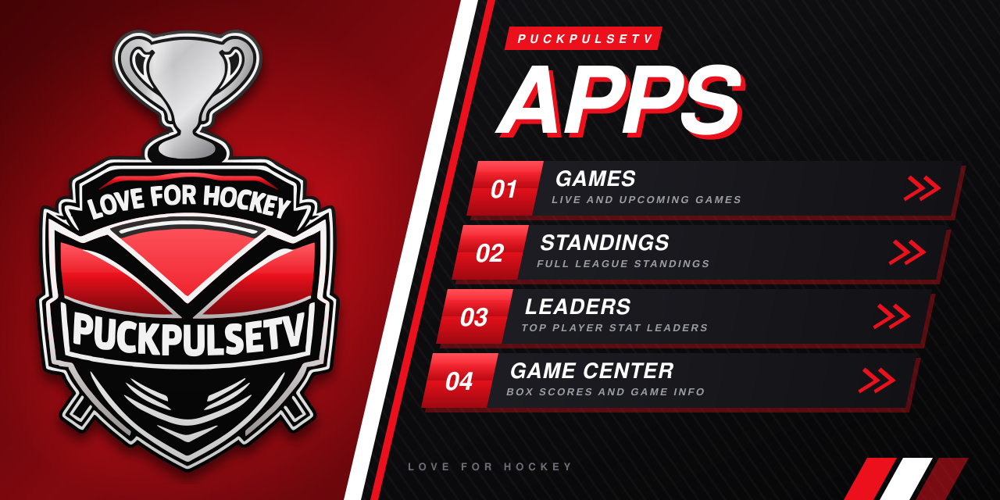

  

  
  

PuckPulseTV brings live hockey scores, schedules, standings, player stats, and detailed Game Centers to your devices.

## Download

| Platform | Status | Download |
|---|---|---|
| Windows 10/11 (64-bit) | Available | [Download the latest installer](https://github.com/Linkbytedev/puckpulsetvapp/releases/latest) |
| Android phone/tablet | Coming soon | Watch this repository for updates |
| Linux (AppImage / .deb) | In development | Available in upcoming release |

For most Windows users, choose **`PuckPulseTV-Setup-1.0.0.exe`**. It installs the app, creates shortcuts, and includes an uninstaller. The portable version runs without installation.

> Windows may show an “Unknown publisher” message while the app is unsigned. Download releases only from this repository or [puckpulsetv.ca](https://puckpulsetv.ca).

## What you get

- Live and upcoming hockey scores
- League standings and player leaders
- Detailed Game Centers with shots, scoring, and penalties
- Team pinning for quick access
- A layout designed for desktop, phone, and TV

## Install on Windows

1. Open [Releases](https://github.com/Linkbytedev/puckpulsetvapp/releases/latest).
2. Download **`PuckPulseTV-Setup-1.0.0.exe`**.
3. Open the installer and select your install location and shortcut options.
4. Launch PuckPulseTV from the desktop or Start menu.

An internet connection is required for live hockey data.

## Updates and support

New versions will be published on the [Releases page](https://github.com/Linkbytedev/puckpulsetvapp/releases). If something is not working, [open an issue](https://github.com/Linkbytedev/puckpulsetvapp/issues/new/choose) and include your app version, Windows version, and a screenshot if possible.

## Links

- [PuckPulseTV website](https://puckpulsetv.ca)
- [Latest release](https://github.com/Linkbytedev/puckpulsetvapp/releases/latest)
- [All releases](https://github.com/Linkbytedev/puckpulsetvapp/releases)

---

<strong>PuckPulseTV</strong> · Hockey, live.

